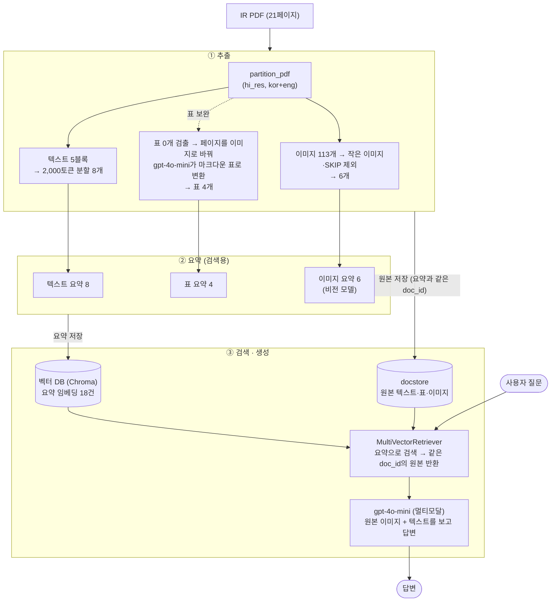
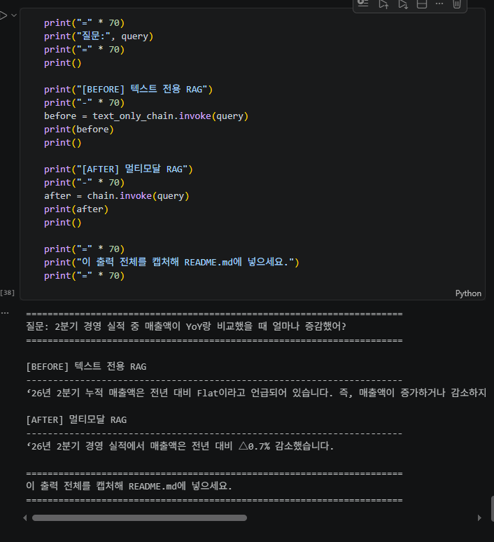

# 멀티모달 RAG: 현대무벡스 2026년 2분기 IR 자료 질의응답

## 1. 프로젝트 개요

- 사용 자료: 현대무벡스 2026년 2분기 IR BOOK (21페이지, 한국어, 공개 자료)
- 출처: https://www.hyundaimovex.com/investment/irView.php?idx=132&p=1
- 원본 PDF와 추출 이미지는 저장소에 포함하지 않았습니다. 자료 2페이지에 반출·복사·재배포 금지 문구가 있어서, 출처 링크로 대신합니다.

## 2. 문제 정의

이 자료는 투자자 설명용 슬라이드를 PDF로 만든 것이라, 질문할 만한 핵심 숫자가 문장보다 **표와 그래프**에 몰려 있습니다.

- 표: 5페이지 2분기 경영 실적(매출액, 영업이익, 수주 잔고와 전년 대비 증감률), 8·21페이지 요약 연결재무제표, 20페이지 주주 현황
- 그래프: 6페이지 사업부별 매출·영업이익, 7페이지 신규 수주·수주 잔고 비중(도넛), 17페이지 연도별 수주 실적, 19페이지 매출·영업이익 추이

그런데 이 숫자들은 PDF에서 글자로 꺼내지지 않는 경우가 많았습니다.

- `pdfplumber`로 5페이지를 읽었을 때 매출액(1,766 / 1,753)과 수주 잔고(3,818)는 **글자 레이어에 존재하지 않았고**, 표의 일부 행만 글자로 나왔습니다. 숫자가 도형이나 이미지로 들어가 있는 것으로 보입니다.
- `partition_pdf(strategy="hi_res")`도 이 자료에서 표를 **하나도 찾지 못했습니다** (Table 0개).
- 그래프의 수치는 처음부터 이미지 안에만 있습니다.

그 결과 텍스트만 읽는 RAG는 "2분기 매출액이 전년 대비 얼마나 증감했나?"라는 기본적인 질문에 "Flat, 구체적인 수치는 없다"고 답했습니다 (8절 Before/After).

**풀려는 문제:** 슬라이드형 IR 자료처럼 핵심 수치가 표와 그래프 이미지에 들어 있는 문서에서, 텍스트 추출로는 사라지는 표·그래프 정보까지 근거로 삼아 질문에 정확한 숫자로 답하는 RAG를 만드는 것입니다.

## 3. 아키텍처



- ① 추출: `partition_pdf`가 표를 찾지 못해서, 페이지를 이미지로 바꾼 뒤 VLM이 표를 마크다운으로 옮겨 적는 경로를 추가했습니다. 이미지는 로고·아이콘·목차처럼 정보가 없는 것을 걸러냈습니다.
- ② 요약: 텍스트·표·이미지를 각각 검색용 요약문으로 바꿉니다.
- ③ 검색·생성: 요약은 벡터 DB에, 원본은 docstore에 같은 `doc_id`로 저장합니다. 질문이 들어오면 요약으로 찾고, 같은 `doc_id`의 원본(표 원문, 이미지)을 멀티모달 LLM에 넘겨 답을 만듭니다.

## 4. 구조 이해: 요약으로 검색하고 원본으로 답하는 이유
이미지와 표는 그 자체로는 질문과 비교할 수 없기 때문에, 내용을 글로 옮긴 요약을 만들어 임베딩하고 이를 검색에 사용합니다.
다만 요약은 검색을 위해 줄인 글이라 수치가 빠지거나 잘못 서술될 수 있습니다. 그래서 요약과 원본에 같은 doc_id를 붙여 각각 벡터 DB와 docstore에 저장하고, 요약으로 찾은 뒤 같은 doc_id의 원본을 꺼내 답변 모델에 전달합니다.
즉 검색에는 비교하기 쉬운 요약을, 답변에는 정보가 온전한 원본을 사용하는 구조입니다.

## 5. 단계별 결과

| 단계 | 결과 |
|---|---|
| 추출 (`partition_pdf`, hi_res) | 텍스트 블록 5개 → 2,000토큰 단위 분할 후 8개, 표 0개, 이미지 113개 |
| 표 보완 (VLM 페이지 변환) | 21페이지 중 4페이지(5, 8, 20, 21)에서 표 4개 |
| 이미지 필터 | 113개 중 작은 이미지 50개, SKIP 57개 제외 → 6개 |
| 요약 | 텍스트 8 / 표 4 / 이미지 6 |
| 색인 | 벡터 DB에 요약 18건 (원본은 같은 doc_id로 docstore에 저장) |

## 6. 기술 선택 근거

| 항목 | 선택 | 이유 |
|---|---|---|
| PDF 파싱 전략 | `partition_pdf(strategy="hi_res")`, `languages=["kor","eng"]` | 그림 영역을 잘라내고 한국어 OCR을 하기 위해 사용 |
| 표 추출 | 페이지를 이미지(200dpi)로 바꿔 `gpt-4o-mini`가 마크다운 표로 변환 | hi_res가 표를 못 찾고 일부 숫자가 글자로 없어, 화면 그대로 읽기 위해 사용 |
| 텍스트 분할 | `chunk_size=2000`, `chunk_overlap=400` (토큰 기준, 교안 기본값 200) | 수치와 설명이 블록 경계에서 끊기지 않도록 겹침을 늘림 |
| 텍스트·표 요약 모델 | `gpt-4o-mini`, `temperature=0` | 매번 같은 요약이 나오고 비용이 낮아 사용 |
| 이미지 요약 모델 | `gpt-4o-mini` | 이미지 입력을 지원하고 호출 비용이 낮아 사용 |
| 임베딩 | `text-embedding-3-small` | 요약 18건 규모에 충분하고 저렴해 사용 |
| 프롬프트 언어 | 텍스트·표 요약: 한국어 / 이미지 요약: 한국어 | 질문과 같은 언어로 임베딩되어 검색이 잘 되도록 한국어 사용 |
| 작은 이미지 기준 | 가로나 세로 150px 미만 제외 | 정보 없는 로고·아이콘에 쓰는 호출 비용을 줄이기 위해 제외 |
| 이미지 SKIP 규칙 | 목차·표지·로고·아이콘·장식 사진은 SKIP으로 답하게 하고 색인에서 제외 | 목차 요약이 검색 상위를 차지해 정답 차트를 밀어내서 제외 |
| 답변 모델 | `gpt-4o-mini`, `temperature=0` | 이미지와 텍스트를 함께 읽고 근거에 충실한 답을 내기 위해 사용 |

## 7. 질의응답 6건

| # | 질문 | 답변 | 근거가 된 원본 종류 |
|---|---|---|---|
| 1 | 2분기 경영 실적 중 매출액이 YoY랑 비교했을 때 얼마나 증감했어? | ‘26년 2분기 경영 실적에서 매출액은 전년 대비 △0.7% 감소했습니다. | 이미지 0 / 표 2 / 텍스트 2 |
| 2 | 26년 2분기 누적 영업이익은 얼마고, 전년 같은 기간보다 얼마나 줄었어? | ‘26년 2분기 누적 영업이익은 26억원이며, 전년 같은 기간인 ‘25년 2분기 누적 영업이익 96억원에 비해 70억원 줄었습니다. | 이미지 0 / 표 3 / 텍스트 1 |
| 3 | 현대무벡스의 최대주주는 누구고 지분율은 몇 %야? | 현대무벡스의 최대주주는 현대 엘리베이터이며, 지분율은 48.9%입니다. | 이미지 1 / 표 0 / 텍스트 3 |
| 4 | 26년 2분기 사업부별 수주현황 보고 어디가 제일 수주 많이 받았는지 알려줘 | 자료에 따르면, 2026년 2분기 사업부별 수주현황에서 가장 많은 수주를 받은 사업부는 물류자동화입니다. 물류자동화 사업부는 전체 수주 실적의 47%를 차지하고 있습니다. | 이미지 0 / 표 1 / 텍스트 3 |
| 5 | 26년 2분기 말 수주 잔고에서 물류자동화가 차지하는 비중은? | ‘26년 2분기 말 수주 잔고에서 물류자동화가 차지하는 비중은 47%입니다. **(오답, 9절 C 참고)** | 이미지 1 / 표 1 / 텍스트 2 |
| 6 | 2023년 수주 실적은 얼마였어? | 2023년 수주 실적은 3,755억 원입니다. | 이미지 1 / 표 1 / 텍스트 2 |

5번은 7페이지의 신규 수주 도넛과 수주 잔고 도넛을 구분하지 못해 신규 수주 비중으로 답한 오답이며, 원인과 개선 방향은 9절 C에 정리함.

## 8. Before / After: 텍스트 RAG vs 멀티모달 RAG

**질문:** 2분기 경영 실적 중 매출액이 YoY랑 비교했을 때 얼마나 증감했어?

| 구분 | 답변 |
|---|---|
| **Before**<br/>텍스트 전용 RAG | ‘26년 2분기 누적 매출액은 전년 대비 Flat이라고 언급되어 있습니다. 즉, 매출액이 증가하거나 감소하지 않았다는 의미입니다. 구체적인 수치는 제공되지 않았습니다. 따라서 YoY 비교 시 매출액의 증감은 없었습니다. |
| **After**<br/>멀티모달 RAG | ‘26년 2분기 경영 실적에서 매출액은 전년 대비 △0.7% 감소했습니다. |



**차이 설명**
Before는 텍스트 청크에서만 근거를 찾았기 때문에 비슷한 맥락의 문장을 가져오다 보니 정확한 수치를 찾지 못했지만, After는 수치가 들어 있는 VLM으로 옮긴 5페이지 표를 찾았기 때문에 정확하게 답했습니다.

## 9. 한계와 개선 방향

질의응답을 돌려 보니 오답의 원인은 대부분 답변 모델이 아니라 앞 단계(표 변환, 이미지 요약)에 있었음.

| 문제 | 증상 | 원인 | 조치 | 결과 |
|---|---|---|---|---|
| A. 병합 머리글로 표 열이 밀림 (8페이지 손익계산서) | 재무제표 질문에서 분기 값과 연간 값을 섞어 답함 | 연도 아래 1Q·2Q로 묶인 병합 머리글을 VLM이 풀지 못함 | 표 변환 프롬프트에 병합 머리글 풀어 쓰기, 행마다 값 개수 맞추기, 행 이름 그대로 쓰기 추가 | 일부 해결. 값은 6개씩 나오나 머리글이 5개라 연간 열이 빠지고 값이 한 칸씩 밀림. 해당 표에 의존하는 질문은 질의응답에서 제외 |
| B. 목차 이미지가 검색을 가로챔 (수주현황 질문) | "자료에 내용이 없다"고 답함 | 4번 반복된 목차 이미지 요약이 검색 상위를 차지하고, 7페이지 도넛 요약은 "예산 분배"로 잘못 서술됨 | 이미지 요약 프롬프트에 제목 그대로 쓰기, 수치 빠짐없이 쓰기, 추측 금지 추가. 목차·로고 등은 SKIP 처리 후 색인에서 제외 | 해결. 수주현황 1위 질문에 정답 |
| C. 비슷한 차트를 구분 못 함 (7페이지 도넛 2개) | 수주 잔고 비중 질문에 신규 수주 비중과 같은 값(47%)으로 답함 | 잘라낸 그림에는 페이지 제목이 없어, 요약에 "신규 수주"·"수주 잔고" 구분어가 들어가지 않음 | 미조치 | 미해결 |
| D. 이미지 필터가 과함 | 113개 중 6개만 색인됨 (작은 이미지 50개, SKIP 57개 제외) | 150px 기준과 SKIP 판단이 실제 차트 일부까지 걸러낸 것으로 보임 | 미조치 | 미해결 |

**개선 방향**

- A: 머리글 수와 행별 값 개수가 다르면 자동으로 감지해 해당 페이지만 상위 모델로 다시 변환
- C: 이미지 요약 시 같은 페이지의 제목·텍스트를 함께 넣거나, 요약 앞에 페이지 번호와 제목을 붙여 차트를 구분
- D: SKIP된 이미지 목록을 출력해 눈으로 검수하고, 크기 기준과 SKIP 규칙을 완화

**그 밖의 한계**

- 14페이지의 작은 표(R&D 센터 개요)는 VLM이 표로 인식하지 못해 누락됨
- 처리 시간: hi_res 파싱 약 1분 이상, 이미지 요약 약 7분
- 검색이 요약에 의존하므로, 요약 품질이 낮으면 원본이 정확해도 찾아오지 못함

## 10. 실행 방법

### 사전 설치

- Python 3.11 ~ 3.12 권장
- Poppler, Tesseract (OS에 직접 설치하고 Path 등록 후 터미널·에디터 재시작)
  - 확인: `pdftoppm -h`, `tesseract -v`

### 설치

```bash
git clone <저장소 주소>
cd multimodal-rag

# 가상환경 생성
python -m venv .venv
```

가상환경을 활성화한 뒤 의존성을 설치합니다.

```bash
# macOS / Linux
source .venv/bin/activate

# Windows PowerShell
.\.venv\Scripts\Activate.ps1

# Windows 명령 프롬프트(cmd)
.venv\Scripts\activate.bat
```

```bash
python -m pip install --upgrade pip
pip install -r requirements.txt
# 또는 고정된 의존성 버전을 사용하려면:
# pip install -r requirements.lock.txt
```

Jupyter에서 사용할 커널을 등록하고 `.env` 파일을 준비합니다.

```bash
python -m ipykernel install --user --name multimodal-rag

# macOS / Linux
cp .env.example .env

# Windows 명령 프롬프트(cmd)
copy .env.example .env

# Windows PowerShell
Copy-Item .env.example .env
```

`.env` 파일을 열어 실제 OpenAI API 키를 입력하세요.

### 실행

1. 출처 링크에서 PDF를 내려받아 `data/2Q26-MOVEX-IR-BOOK.pdf` 로 저장합니다. (파일명은 영문, 공백 없이)
2. `notebooks/Multi_modal_RAG.ipynb` 를 열고 커널을 `.venv`로 선택합니다.
3. 위에서부터 순서대로 실행합니다. (Part 1 추출 → Part 2 요약 → Part 3 검색·답변)
   - 중간 결과는 `data/processed/` 에 pkl로 저장되며 Git에는 올리지 않습니다.

## 11. 프로젝트 구조

```text
multimodal-rag/
├── data/                         # PDF, figures/, processed/ (모두 Git 제외)
├── docs/
│   └── before_after.png          # Before/After 실행 화면 캡처
├── notebooks/
│   └── Multi_modal_RAG.ipynb     # 과제 본체 (추출 → 요약 → 검색·생성 전체 실행)
├── src/
│   ├── extract.py                # PDF 추출 (텍스트·이미지, VLM 표 변환)
│   ├── summarize.py              # 텍스트·표·이미지 요약
│   └── retriever.py              # 다중 벡터 검색기와 최종 체인
├── .env.example
├── .gitignore
├── requirements.txt
├── requirements.lock.txt
└── README.md
```

## 12. 보안 처리

- `.env` 는 Git에 올리지 않고, 필요한 변수는 `.env.example` 로 안내합니다.
- `.gitignore`: `.venv/`, `.env`, `data/figures/`, `*.pdf`, `data/processed/`, `data/table_pages_cache.json`, `chroma_db/`, `__pycache__/`, `.ipynb_checkpoints/` 등
- 노트북에는 API 키를 앞 7자와 뒤 4자만 출력합니다.
